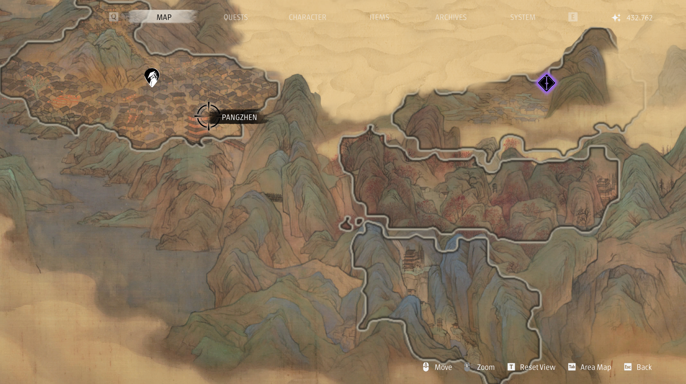

# World Map Outlines

The world map outlines every region you have discovered, all the time. No image files, no game file replaced. A PBZModLoader mod.

## What it does

The world map shows a soft outline around every region you have discovered, all the time, without moving the cursor
over each one.

- A region counts as discovered by the map's own rule: you have rung one of its bells.
- The outlines follow the map when you pan and zoom, sit below the game's fog and markers, and never block the cursor.
- Eight regions: Xigu, Fuji Forest (fujizhilin), Lu Village (lujiacun), the Righteous Union Camp (zhengdaodaying),
  Dengding Island (dengdingshandao), Duanhun Cliff (duanhunya), Meigu Lake (meiguhu) and Pangzhen.

It is a PBZModLoader mod: a script in the game's own script engine. The outlines are inside the script: no image files,
no game file replaced, nothing written into the save.

## Screenshots

## How to install

1. Install [PBZModLoader](https://github.com/KintaroModding/phantombladezero_pbzmodloader) 2.1.0 or later.
2. Download the zip of the latest release on GitHub (`phantombladezero_worldmapoutlines_<version>.zip`).
3. Unpack it into the game folder (the folder that holds `ProjectPBZ`). It adds the folder
   `ProjectPBZ\PBZModLoader\mods\phantombladezero_worldmapoutlines\` with `main.js` and the settings file.
4. Start the game.

To check that it runs: `ProjectPBZ\PBZModLoader\loader.log` has the line
`[PBZMOD] [World Map Outlines] <version> started; settings: ...`.

To update the mod, replace `main.js` with the one of the new release; keep your settings file (a setting that it does
not have keeps its default). To remove the mod, delete the folder `ProjectPBZ\PBZModLoader\mods\phantombladezero_worldmapoutlines\`.

## How to use

Nothing to do: open the world map.

## Settings

The settings are in `ProjectPBZ\PBZModLoader\mods\phantombladezero_worldmapoutlines\phantombladezero_worldmapoutlines.txt`. Open it with a text editor,
change a value and save: the open world map takes it within 2 seconds, without a restart. Without the
file the mod writes it with the defaults below. Keys are not case-sensitive; `;` or `#` starts a comment.

**With Mods Menu** (0.9.0 or later) in the game, the mod adds its page to Mods Menu's tab in the game's settings, and
the page's settings are the ones that count: Mods Menu keeps them in its own file in the game's `Saved` folder, and
the file in the mod's folder is not read then.

| Setting | Default | What it does |
|---|---|---|
| `Enable` | `On` | `Off`: the game's own world map |
| `Opacity` | `1` | How strong the outlines show, 0.1 to 1 (1 = as drawn) |

## Compatibility

- Game version: Steam build 26367565 (`CL-302256_JKS-17280`).
- Needs PBZModLoader 2.1.0 or later. Mods Menu is optional.
- The earlier "TracedLands" (UE4SS with loose images, or a pak): remove it first, or the outlines show twice.
- Mods that change the map script: this mod replaces no script; it wraps the map's own method, so it works next to
  mods that do the same, and next to a pak that replaces `Map.js` (it then wraps that one).

## Known issues

- None known.

## How to build

There is nothing to build: `src\phantombladezero_worldmapoutlines\` is the mod folder (`main.js` and the settings file).
`tests\test_mod.js` runs the script outside the game with Node.js and stand-ins for the game: `node tests\test_mod.js`.
`README.md` has the details.

## Credits

Made by Kintaro. MIT license: you may use, change and share this mod. PBZModLoader is made by LKF, its fork by
KintaroModding. Phantom Blade Zero and its files belong to their makers.
